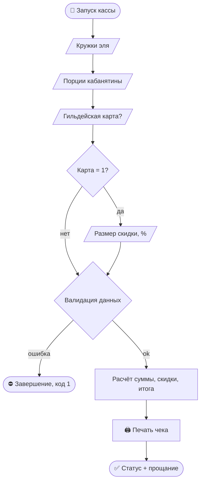

# 🍺 Таверна «У кода»
### _Кассовый модуль фэнтезийной таверны — консольное приложение на C++_


> [!QUOTE]+
> «Пока варится эль — код трактирщика компилируется без предупреждений.»
> — надпись над камином в общем зале

> [!INFO]- 🗺️ Содержание
> - [[#📖 Легенда|Легенда]]
> - [[#✨ Возможности|Возможности]]
> - [[#🍖 Прейскурант|Прейскурант]]
> - [[#🧮 Формула расчёта|Формула расчёта]]
> - [[#🚀 Сборка и запуск|Сборка и запуск]]
> - [[#📺 Демонстрация|Демонстрация]]
> - [[#🛡️ Валидация ввода|Валидация ввода]]
> - [[#🧠 Архитектура|Архитектура]]
> - [[#📄 Исходный код|Исходный код]]
> - [[#🔮 Roadmap гильдии|Roadmap]]

## 📖 Легенда

Пятница, вечер. Гном требует *четвёртую* порцию кабанятины, эльф спорит о скидке, а трактирщик в третий раз пересчитывает сдачу на счётах и путается в нулях.

==«У кода»== — таверна, где даже сдать лабу можно за кружкой эля. Эта программа заменяет счёты: принимает заказ, применяет гильдейскую скидку и печатает аккуратный чек. Счета — в музей.

## ✨ Возможности

- [x] Приём заказа: кружки эля 🍺 и порции кабанятины 🐗
- [x] Гильдейская карта — скидка задаётся **в процентах**
- [x] Автоматический расчёт суммы, скидки и итога
- [x] Чек с выровненными колонками — как в настоящей кассе
- [x] Защита от букв, дробей и прочего мусора во вводе
- [x] Понятные коды возврата: `0` — успех, `1` — ошибка данных

## 🍖 Прейскурант
>Все цены указаны в медяках[^1].

|  #  | Позиция              |    Цена | Комментарий трактирщика                |
| :-: | -------------------- | ------: | -------------------------------------- |
|  1  | 🍺 Кружка эля        | 35 мед. | «Только из-под пивовара!»              |
|  2  | 🐗 Порция кабанятины | 90 мед. | Кабан был крупный, честное гильдейское |

> [!TIP] Меню меняется в одном месте
> Цены заданы константами `ALE_PRICE` и `BOAR_PRICE` в начале `tavern.cpp`. Прейскурант правится без touches логики расчёта.

## 🧮 Формула расчёта

$$
S = q_{a} \cdot P_{a} + q_{b} \cdot P_{b}
$$

$$
D = \frac{S \cdot n}{100}, \qquad T = S - D
$$

| Символ | Значение |
|:------:|----------|
| $q_a,\ q_b$ | количество кружек эля / порций кабанятины |
| $P_a,\ P_b$ | цены из прейскуранта |
| $S$ | сумма без скидки |
| $n$ | скидка по гильдейской карте, % |
| $D,\ T$ | скидка и итог к оплате |

> [!EXAMPLE]- 🧾 Пример: 3 эля, 2 кабанятины, скидка 10 %
> $S = 3 \cdot 35 + 2 \cdot 90 = 285$ → скидка $D = 28.5$ → к оплате $T = \mathbf{256.5}$ медяков

## 🚀 Сборка и запуск

```bash
g++ -std=c++17 -o tavern tavern.cpp

./tavern        # Linux / macOS
.\tavern.exe    # Windows (PowerShell)
```

> [!NOTE] Visual Studio
> Пустой консольный проект → добавить `tavern.cpp` → `Ctrl+F5`. Внешних зависимостей нет — только стандартная библиотека.

> [!WARNING] Про ввод
> Весь ввод идёт через `readInt()` — построчно, через `getline`. **Не смешивай** его с `std::cin >>`: они конфликтуют за один буфер, и следующий `getline` прочитает пустую строку.

> [!NOTE]- Про кодировку и выравнивание
> Колонки чека выровнены под однобайтовую кириллицу (CP1251 — стандарт для Windows-консоли)[^2]. Под Linux/UTF-8 правый край денежных колонок может уехать: `std::setw` считает байты, а не символы.

## 📺 Демонстрация

```text
===============================================
                 ТАВЕРНА «У КОДА»
              Кассовый модуль, версия 1.0
===============================================

--- РЕГИСТРАЦИЯ ЗАКАЗА ГОСТЯ ---

Кружки эля, шт (35 мед./шт): 3
Порции кабанятины, шт (90 мед./шт): 2
Предъявлена гильдейская карта? (1 - да / 0 - нет): 1
Размер скидки по карте, %: 10

[ТАВЕРНА] Заказ принят, выполняется расчет стоимости...

-----------------------------------------------
                     ЧЕК ЗАКАЗА
-----------------------------------------------
Наименование      Кол-во    Цена     Сумма
-----------------------------------------------
Кружка эля             3    35.0     105.0 мед.
Порция кабанятины      2    90.0     180.0 мед.
-----------------------------------------------
Сумма без скидки:                      285.0 мед.
Скидка гильдии (10 %):                 -28.5 мед.
-----------------------------------------------
ИТОГО К ОПЛАТЕ:                        256.5 мед.
===============================================

[ТАВЕРНА] ЧЕК СФОРМИРОВАН: гильдейская скидка применена.

«Спасибо за визит, странник!»
```

## 🛡️ Валидация ввода

| Ввод гостя | Реакция программы |
|------------|-------------------|
| `abc` | одна ошибка → повторный запрос |
| `12abc` | одна ошибка — лишние символы после числа |
| `3,5` | одна ошибка — не целое число |
| пустой Enter | одна ошибка |
| отрицательное количество | завершение, код `1` |
| пустой заказ (0 и 0) | завершение, код `1` |
| скидка вне диапазона 0–100 % | завершение, код `1` |
| Ctrl+Z / Ctrl+D | аккуратное завершение, без зацикливания |

> [!IMPORTANT] Философия валидации
> Ошибка **формата** (буквы, дроби, мусор) → сообщение один раз и повторный ввод.
> Ошибка **значения** (минусы, пустой заказ) → завершение с кодом `1`. Как в приличной кассе.
> Прерывание потока (Ctrl+Z / Ctrl+D)[^3] тоже обрабатывается — без бесконечного спама.

## 🧠 Архитектура



| Функция | Ответственность |
|---------|-----------------|
| `readInt()` | безопасный ввод целых: `getline` + `istringstream` |
| `printLine()` | разделительные линии чека |
| `printOrderLine()` | строка позиции: наименование / кол-во / цена / сумма |
| `printTotalLine()` | строка итогов, выравнивание по денежной колонке |
| `showTavernStatus()` | статусы обслуживания в формате `[ТАВЕРНА] ...` |
| `main()` | дирижёр: ввод → валидация → расчёт → чек |

## 📄 Исходный код

<details>
<summary>🍺 <b>tavern.cpp</b> — нажми, чтобы развернуть</summary>

```cpp
#include <iostream>
#include <iomanip>
#include <string>
#include <sstream>
#include <cstdlib>
#include <clocale>

// ============================================================
//  ТАВЕРНА «У КОДА» — автоматизация кассы
// ------------------------------------------------------------
//  Вход:  количество кружек эля, порций кабанятины, наличие
//         гильдейской карты и размер скидки в процентах.
//  Выход: итоговый чек в текстовом формате.
// ============================================================

// ---------- Константы прейскуранта ----------
const double ALE_PRICE  = 35.0;  // кружка эля
const double BOAR_PRICE = 90.0;  // порция кабанятины
const int    LINE_WIDTH = 47;    // ширина чека

// ---------- Вспомогательные функции ----------

// Печать горизонтальной линии заданным символом
void printLine(const char symbol) {
    std::cout << std::string(LINE_WIDTH, symbol) << "\n";
}

// Кастомная функция для вывода статуса обслуживания
void showTavernStatus(const std::string& message) {
    std::cout << "\n[ТАВЕРНА] " << message << "\n";
}

// Безопасный ввод целого числа: строка читается целиком,
// при ошибке сообщение выводится один раз — и снова к промпту
int readInt(const std::string& prompt) {
    std::string line;

    while (true) {
        std::cout << prompt;

        // Читаем строку целиком — «мусор» не остаётся в буфере
        if (!std::getline(std::cin, line)) {
            std::cout << "\n[ОШИБКА] Ввод прерван (поток закрыт).\n";
            std::exit(1);
        }

        std::istringstream iss(line);
        int  value = 0;
        char extra = '\0';

        // Корректный ввод: из строки прочиталось целое число
        // и после него нет лишних символов
        if (iss >> value && !(iss >> extra)) {
            return value;
        }

        std::cout << "[ОШИБКА] Требуется целое число. Повторите ввод.\n";
    }
}

// Строка заказа: наименование | количество | цена | сумма
void printOrderLine(const std::string& title, int qty, double price) {
    std::cout << std::left  << std::setw(18) << title
              << std::right << std::setw(6)  << qty
              << std::setw(8)  << price
              << std::setw(10) << qty * price << " мед.\n";
}

// Строка итогов: подпись слева, сумма в денежной колонке чека
void printTotalLine(const std::string& label, double amount) {
    std::cout << std::left  << std::setw(32) << label
              << std::right << std::setw(10) << amount << " мед.\n";
}

int main() {
    std::setlocale(0, "");
    std::cout << std::fixed << std::setprecision(1); // денежный формат: 1 знак после запятой

    // ---------- 0. Шапка ----------
    printLine('=');
    std::cout << "                 ТАВЕРНА «У КОДА»\n";
    std::cout << "              Кассовый модуль, версия 1.0\n";
    printLine('=');

    // ---------- 1. Ввод данных ----------
    std::cout << "\n--- РЕГИСТРАЦИЯ ЗАКАЗА ГОСТЯ ---\n\n";
    const int aleQty  = readInt("Кружки эля, шт (35 мед./шт): ");
    const int boarQty = readInt("Порции кабанятины, шт (90 мед./шт): ");
    const int hasCard = readInt("Предъявлена гильдейская карта? (1 - да / 0 - нет): ");

    int discountPercent = 0;
    if (hasCard == 1) {
        discountPercent = readInt("Размер скидки по карте, %: ");
    }

    // ---------- 2. Валидация входных данных ----------
    if (aleQty < 0 || boarQty < 0) {
        std::cout << "\n[ОШИБКА] Количество не может быть отрицательным.\n";
        return 1;
    }
    if (aleQty == 0 && boarQty == 0) {
        std::cout << "\n[ОШИБКА] Заказ пуст: не выбрано ни одной позиции.\n";
        return 1;
    }
    if (hasCard != 0 && hasCard != 1) {
        std::cout << "\n[ОШИБКА] Ответ о карте должен быть 1 (да) или 0 (нет).\n";
        return 1;
    }
    if (discountPercent < 0 || discountPercent > 100) {
        std::cout << "\n[ОШИБКА] Скидка должна быть в диапазоне от 0 до 100 %.\n";
        return 1;
    }

    showTavernStatus("Заказ принят, выполняется расчет стоимости...");

    // ---------- 3. Расчет стоимости ----------
    const double aleTotal  = aleQty  * ALE_PRICE;
    const double boarTotal = boarQty * BOAR_PRICE;
    const double subtotal  = aleTotal + boarTotal;               // сумма без скидки
    const double discount  = subtotal * discountPercent / 100.0; // скидка, медяков
    const double total     = subtotal - discount;                // итог к оплате

    // ---------- 4. Печать чека ----------
    std::cout << "\n";
    printLine('-');
    std::cout << "                     ЧЕК ЗАКАЗА\n";
    printLine('-');
    std::cout << std::left  << std::setw(18) << "Наименование"
              << std::right << std::setw(6)  << "Кол-во"
              << std::setw(8)  << "Цена"
              << std::setw(10) << "Сумма" << "\n";
    printLine('-');

    if (aleQty  > 0) printOrderLine("Кружка эля",        aleQty,  ALE_PRICE);
    if (boarQty > 0) printOrderLine("Порция кабанятины", boarQty, BOAR_PRICE);
    printLine('-');

    printTotalLine("Сумма без скидки:", subtotal);
    if (discount > 0.0) {
        printTotalLine("Скидка гильдии (" + std::to_string(discountPercent) + " %):", -discount);
    }
    printLine('-');
    printTotalLine("ИТОГО К ОПЛАТЕ:", total);
    printLine('=');

    // ---------- 5. Итоговый статус ----------
    if (discount > 0.0) {
        showTavernStatus("ЧЕК СФОРМИРОВАН: гильдейская скидка применена.");
    } else {
        showTavernStatus("ЧЕК СФОРМИРОВАН: расчет по стандартному прейскуранту.");
    }
    std::cout << "\n«Спасибо за визит, странник!»\n";

    return 0;
}
```

</details>

## 🔮 Roadmap гильдии

- [ ] Тарифы карт: бронза — 5 %, серебро — 10 %, золото — 15 %
- [ ] Сохранение чеков в файл для отчётности перед гильдией купцов
- [ ] Чаевые бардскому ансамблю (обязательные, разумеется)
- [ ] Налог Лорда-Протектора — как же без него
- [ ] Округление итога до целых медяков в пользу трактирщика 🤫

## 📝 Сноски

[^1]: Медяк — основная валюта королевства. Курс к золоту нестабилен, как и требования заказчика.
[^2]: `std::setw` считает байты: CP1251 — по 1 байту на кириллический символ, UTF-8 — по 2.
[^3]: Windows — `Ctrl+Z` и Enter; Linux/macOS — `Ctrl+D`.

---

*Проект учебный. Все совпадения с реальными тавернами случайны, а эль — строго по гильдейской карте.* 🍺
````

Пара замечаний по проверке в Obsidian:

- **Спец-фичи, которые должны отрендериться:** callout-блоки `> [!TYPE]` (сворачиваемые — с минусом после типа, как у «Содержание» и «Пример»), схема Mermaid, формулы `$$…$$` и инлайн `$…$`, сноски `[^1]`, выделения `==вот такие==`, чекбоксы, `<details>`, frontmatter сверху.
- **Frontmatter:** если вставляешь текст в уже существующую заметку, а не создаёшь новый файл — удали блок между первыми двумя `---`, иначе он отобразится как текст.
- **Ссылки в содержании** — виклинки на заголовки, работают только внутри Obsidian (в GitHub-превью будут просто текстом).
- **Бейджи-картинки** грузятся с shields.io — офлайн покажутся заглушками; не нужны — просто удали эту строку.